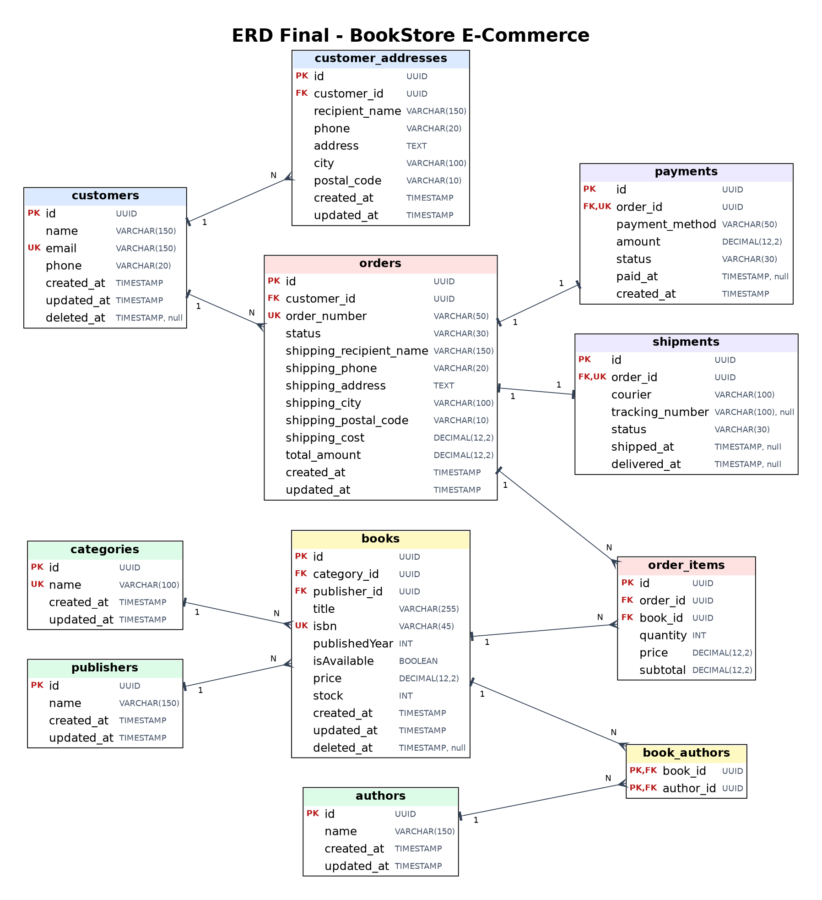

# BookStore E-Commerce (NestJS + TypeORM + MySQL)

Tugas perancangan database relasional untuk aplikasi e-commerce penjualan buku.

## Tabel (11)
customers, customer_addresses, categories, publishers, authors, books,
book_authors, orders, order_items, payments, shipments

ERD (gambar): 

Keputusan desain & kode Mermaid: [docs/ERD.md](docs/ERD.md)

## Cara menjalankan
1. Install dependency
   ```bash
   npm install
   ```
2. Buat database MySQL (Laragon) bernama `bookstore`, lalu sesuaikan `.env`
   (contoh ada di `.env.example`).
3. Jalankan aplikasi (tabel dibuat otomatis lewat `synchronize`)
   ```bash
   npm run start:dev
   ```

## Struktur
```
src/
├── common/decimal.transformer.ts
├── entities/        # 11 entity TypeORM
├── app.module.ts
└── main.ts
docs/ERD.md
```
