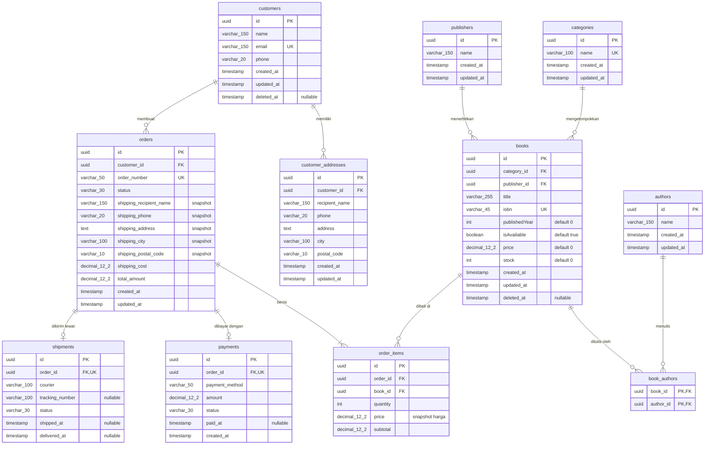

# ERD Final – BookStore E-Commerce

> Tempel blok `mermaid` di bawah ke https://mermaid.live (atau draw.io → Arrange → Insert → Advanced → Mermaid) untuk mendapatkan gambar ERD.



## Ringkasan Relasi & Kardinalitas

| Parent | Child | Relasi | FK |
|---|---|---|---|
| customers | customer_addresses | 1 : N | customer_addresses.customer_id |
| customers | orders | 1 : N | orders.customer_id |
| categories | books | 1 : N | books.category_id |
| publishers | books | 1 : N | books.publisher_id |
| books | book_authors | 1 : N | book_authors.book_id |
| authors | book_authors | 1 : N | book_authors.author_id |
| orders | order_items | 1 : N | order_items.order_id |
| books | order_items | 1 : N | order_items.book_id |
| orders | payments | 1 : 1 (sederhana) | payments.order_id (UNIQUE) |
| orders | shipments | 1 : 1 (sederhana) | shipments.order_id (UNIQUE) |

Relasi **books N : N authors** diwujudkan lewat tabel penghubung `book_authors` (PK gabungan `book_id + author_id`).

## Keputusan Desain (untuk dijelaskan di laporan)

1. **Kolom `author` dihapus dari `books`.** Penulis dikelola lewat `authors` + `book_authors`. Kalau dua-duanya dipakai, terjadi redundansi dan data bisa tidak konsisten (melanggar normalisasi).
2. **Tambah `price` & `stock` di `books`**, sesuai rekomendasi tugas. `price` memakai `DECIMAL(12,2)` (bukan FLOAT) agar tidak ada masalah presisi.
3. **Tambah `category_id` & `publisher_id` di `books`** sebagai FK untuk relasi one-to-many.
4. **`title` diperbesar ke 255** (sebelumnya 30), karena judul buku sering panjang.
5. **`order_items.price` = snapshot harga saat beli**, bukan duplikasi `books.price`, agar riwayat transaksi tidak berubah ketika harga katalog berubah.
6. **Snapshot alamat pengiriman di `orders`** (`shipping_*`), jadi perubahan/penghapusan alamat pelanggan tidak mengubah riwayat pesanan lama.
7. **`orders.total_amount` = SUM(order_items.subtotal) + shipping_cost**, dihitung di service dalam satu transaksi DB agar konsisten.
8. **`payments.order_id` dan `shipments.order_id` UNIQUE** → 1:1 untuk rancangan sederhana. Untuk mendukung banyak percobaan pembayaran, cukup hapus constraint UNIQUE (jadi 1:N).
9. **Integritas data:** `UNIQUE` (email, isbn, order_number, nama kategori, order_id pada payments & shipments), `UNIQUE(order_id, book_id)` di order_items, foreign key dengan `onDelete RESTRICT` untuk data master yang sudah dipakai transaksi dan `CASCADE` untuk data turunan. Aturan nilai (stok ≥ 0, harga ≥ 0, quantity > 0) divalidasi di lapisan aplikasi (service/DTO), karena TypeORM tidak mendukung CHECK constraint pada MySQL.
10. **Soft delete** (`deleted_at`) dipakai di `customers` dan `books`, sesuai spesifikasi.
11. **Normalisasi:** semua tabel memenuhi 1NF (atribut atomik), 2NF (tidak ada dependensi parsial; tabel penghubung hanya berisi key), dan 3NF (tidak ada dependensi transitif; data kategori/penerbit/penulis dipisah ke tabelnya sendiri).

## Contoh konfigurasi NestJS

```ts
// app.module.ts
import { TypeOrmModule } from '@nestjs/typeorm';
import { entities } from './entities';

TypeOrmModule.forRoot({
  type: 'mysql',
  host: 'localhost',
  port: 3306,
  username: 'root',
  password: '',
  database: 'bookstore',
  entities,
  synchronize: true, // hanya untuk development/tugas
});
```
